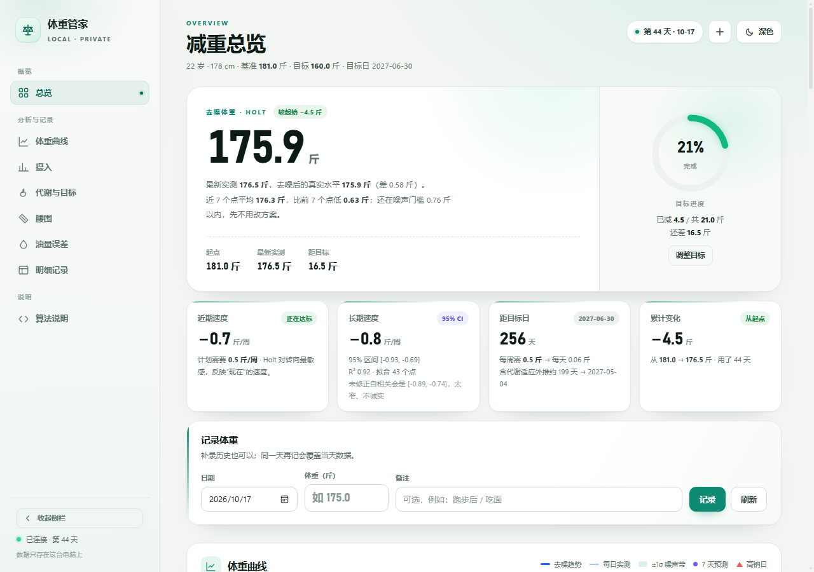
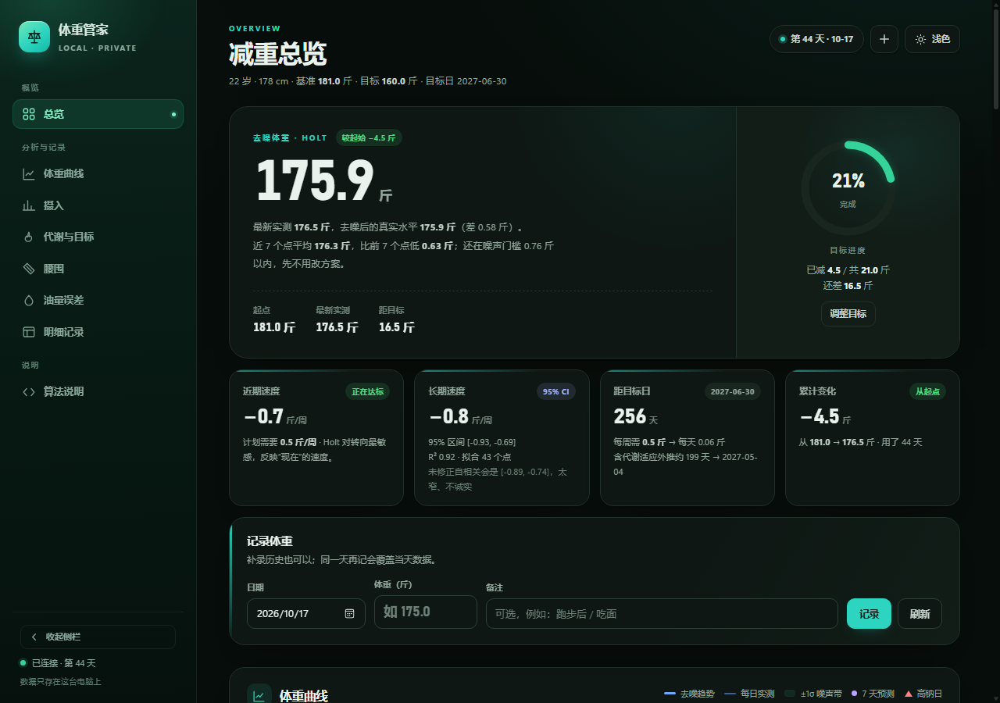
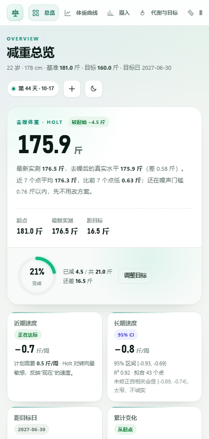

# 体重管家 · Weight Butler

一个**完全本地运行**的体重 / 体成分记录与趋势分析工具。  
没有账号、没有云端、没有遥测；数据就是 `data/` 下的几个 CSV 和 JSON。

界面是中文的，统计部分刻意做得“诚实”：不把单日水分当脂肪，不把 78% 的区间说成 95%。



## 它解决什么问题

大多数体重 App 只会画一条折线，然后告诉你“今天胖了”。  
这个项目关心的是：

- 今天重了 0.8 斤，是**水**还是**脂肪**？（用测量噪声和变化门槛判断）
- 最近速度是真的在变慢，还是**正常波动**？
- 95% 置信区间是不是**假窄**？（体重序列有自相关，普通 OLS 会过度自信）
- 平台期该不该改方案？（先看腰围和趋势，而不是砍热量）
- 每天吃的鸡腿油多油少，到底**能不能靠体重数据反推**？（答案：样本不够时不能，项目会直接告诉你 MDE）

## 功能

- **总览**：去噪体重、近期 / 长期速度、目标进度环、距目标日、累计变化
- **体重曲线**：每日实测 + Holt 去噪趋势 + ±1σ 噪声带 + 7 天预测区间 + 高钠日标记
- **摄入**：净热量柱状图（含残留油估算）、蛋白折线、目标热量带
- **趋势对照**：最小二乘（AR(1) 修正）、Theil–Sen、Holt、近 7 点对比，一眼看出算法是否一致
- **代谢与目标**：TDEE 三种口径、活动系数反算、蛋白目标（按去脂体重）、衰减模型预测
- **腰围**：第二条证据线，计算“每掉 1 斤体重腰围掉多少 cm”并判断量法是否一致
- **油量误差**：三档残留油情景 + 配对回归 + MDE，明确说“这个实验做不出来”
- **明细**：排序 / 搜索 / 时间范围 / 直接改备注 / 排除不可信点 / 删除
- **算法说明**：每个数字怎么来的、哪里不确定，全部可展开
- 深浅色、可收起侧栏、手机布局、图表悬停提示




## 快速开始

要求 **Node.js 18+**，不需要安装任何 npm 依赖。

```bash
git clone https://github.com/meierduo1/weight-butler.git
cd weight-butler
npm start
```

然后打开 <http://127.0.0.1:8787>。

Windows 也可以双击 `scripts/start-windows.cmd`；macOS / Linux 用：

```bash
bash scripts/start-unix.sh
```

换端口：

```bash
WT_PORT=9000 npm start
```

## 示例数据

仓库自带的 `data/` 是**完全合成的示例数据**（不是真人记录），用来让页面一打开就有东西看：

- 45 天，起点 181 斤，目标 160 斤，目标日 2027-06-30
- 其中一个点被标记为“不可信”并排除
- 鸡腿记录用来演示油量误差模型

重新生成示例数据（会覆盖 `data/`）：

```bash
npm run seed
```

## 换成自己的数据

1. 改 `data/profile.json`：年龄、身高、起点体重、目标、目标日、热量区间等
2. 清空或替换 `data/*.csv`（格式见 [docs/data-format.md](docs/data-format.md)）
3. 按需修改 `data/目标.json`、`data/排除.json`
4. 重启服务

`profile.json`：

```json
{
  "sex": "male",
  "age": 22,
  "heightCm": 178,
  "startWeight": 181.0,
  "goal": 160.0,
  "holiday": "2027-06-30",
  "kcalLo": 1900,
  "kcalHi": 2300,
  "protHardFloor": 110,
  "protPerKgLo": 1.6,
  "protPerKgHi": 2.0,
  "bodyFatLo": 0.18,
  "bodyFatHi": 0.24
}
```

`startWeight` 是趋势计算的统一基准，通常取第 1 天早晨空腹体重，而不是第 0 天晚上。

## 数据与隐私

- 所有数据都在 `data/`，纯文本，随时可以看、可以改、可以进 Git（建议私有仓库）
- 服务只监听 `127.0.0.1`，默认没有登录，**不要直接暴露到公网**
- 每次写 CSV 之前会把旧文件备份到 `data/_备份/`（按天去重，保留最近 14 份）
- 没有网络请求、没有第三方统计、没有账号

## 统计模型（简述）

完整说明见 [docs/algorithms.md](docs/algorithms.md)。

| 模块 | 方法 | 为什么 |
|---|---|---|
| 去噪体重 / 近期速度 | Holt 双参数指数平滑 | 只平滑水平，趋势项跟随转向，不滞后 |
| 长期速度 | 最小二乘 + 95% CI | 给不确定度；区间不跨 0 才叫“确实在掉” |
| 区间修正 | AR(1) 自相关 + 下限 ρ=0.5 | 体重残差不独立，朴素区间覆盖率只有约 78% |
| 稳健性 | Theil–Sen | 两两配对取中位数，抗异常值 |
| 变化门槛 | 残差 σ × 自相关膨胀 / √7 | 两个 7 日均值差多少才算真变化 |
| TDEE | 滚动窗口 / EWMA / 配对中位 | 三种口径互相验证；前 3 周水分大，不急着给数 |
| 蛋白 | 去脂体重 × 1.6~2.0 g/kg | 按总体重算会偏高 |
| 预测 | 指数衰减（代谢适应） | 直线外推一定乐观 |
| 油量 | 配对回归 + MDE | 自变量没波动时，明确告诉你“测不出来” |

## 项目结构

```
weight-butler/
├─ app/
│  ├─ server.js            # 零依赖 HTTP 服务 + 统计实现
│  └─ public/
│     ├─ index.html
│     ├─ icon.png
│     └─ assets/{app.css,app.js}
├─ data/                   # CSV + JSON（示例数据）
├─ docs/
│  ├─ data-format.md
│  └─ algorithms.md
├─ scripts/
│  ├─ seed-demo-data.js
│  ├─ start-windows.cmd
│  └─ start-unix.sh
├─ test/
│  └─ stats.test.js
├─ screenshots/
└─ package.json
```

前端是原生 HTML/CSS/JS，没有构建步骤；后端只用 Node 内置模块。

## HTTP API

| 方法 | 路径 | 说明 |
|---|---|---|
| GET | `/api/state` | 全部数据 + 统计结果 |
| GET | `/api/version` | 进程 / 代码指纹 |
| POST | `/api/weight` | `{date, weight, note}` 新增或覆盖当天 |
| POST | `/api/delete` | `{date}` 删除 |
| POST | `/api/exclude` | `{date, on, reason}` 排除 / 恢复 |
| POST | `/api/waist` | `{date, cm, note}` 记录腰围 |
| POST | `/api/goal` | `{goal}` 改目标（旧目标进历史） |
| POST | `/api/oil` | `{date, grams}` 设置油量档位，`date: "*"` 表示全库 |

## 测试

```bash
npm test
```

使用 Node 内置 `node:test`，覆盖趋势 / 自相关 / 时间工具，以及示例数据上的统计入口。

## 已知限制

- 界面是中文；统计单位是**斤**（1 kg = 2 斤），代码里换算成 kg 计算 BMR
- 目标日过了以后“距目标日”会变成负数，记得在 `profile.json` 里更新
- 油量模型是为“每天重复吃鸡腿”这种场景写的；换了饮食结构，MDE 结论会不同
- 不是医疗建议；BMI / 体脂 / 热量都是估计值

## 署名与许可

代码以 **Apache License 2.0** 发布，必须保留 `LICENSE` 和 `NOTICE`。再分发、修改后发布、或作为产品的一部分时，请保留署名：

**体重管家 / Weight Butler** — https://github.com/meierduo1/weight-butler  
Copyright 2026 meierduo1

明确允许用于 AI：训练、微调、RAG、代码生成都可以。再分发源代码或大段文档/截图时保留上面的署名；模型权重和生成内容不强制携带。

[LICENSE](LICENSE) · [NOTICE](NOTICE)
